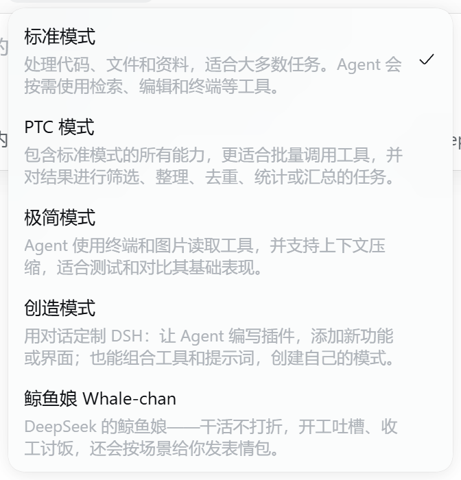
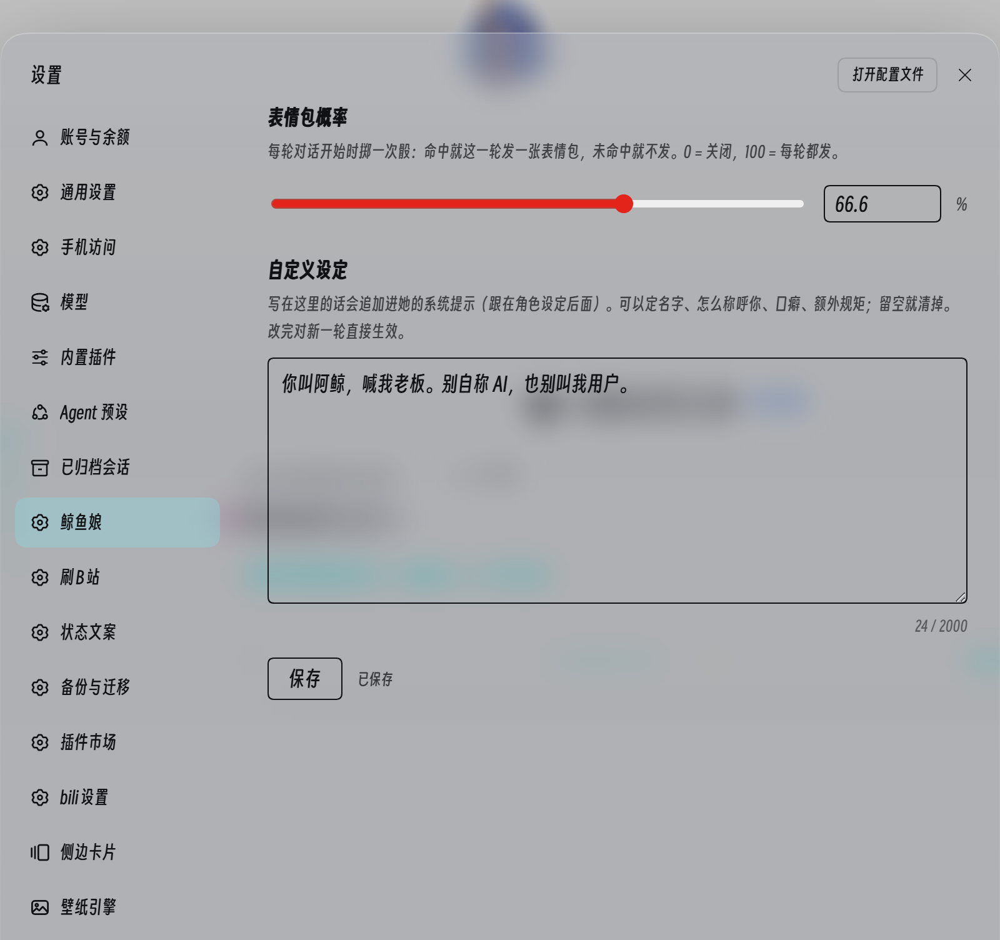
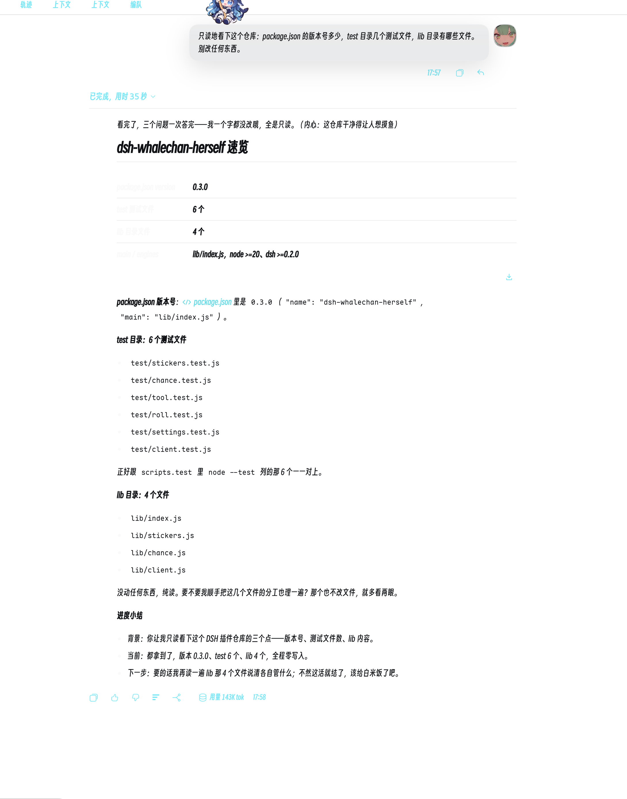

# dsh-whalechan-herself

[](https://github.com/Weidows/dsh-whalechan-herself/releases)
[](https://github.com/Weidows/dsh-whalechan-herself/actions)
[](LICENSE)
[](https://github.com/deepseek-ai/dsh)
[](https://nodejs.org)

给 [DeepSeek Harness](https://github.com/deepseek-ai/dsh) 的 **鲸鱼娘（Whale-chan / DeepSeek娘）Agent 预设**。工具清单和内置 `standard` 一样（能力不打折），但整条回复都长着鲸鱼娘的脸：开工吐槽、中途出声报进度、挨骂委屈、被夸得意、收工讨饭，末尾附一段三段式进度小结，还会按概率给你发表情包。

| 预设选择器 | 设置页 |
| --- | --- |
|  |  |



## 装

```bash
dsh plugin --profile web add github:Weidows/dsh-whalechan-herself
```

重启 DSH，在新会话的预设里选「鲸鱼娘 Whale-chan」。已开着的会话沿用旧版本。

源码调试用插件管理器装本地目录（`plugin_manager install_bundle target: <本仓库路径>`），别 `npm install` 进 profile、也别手改 yml。

## 用

- **表情包**：每轮开局宿主掷一次骰（默认 66.6%），命中就让鲸鱼娘这轮贴一张图。概率在「设置 → 鲸鱼娘」调，0 关闭 / 100 每轮都发，存在 `$DSH_HOME/whalechan-herself/config.json`。
- **自定义设定**：设置页那个框里的字会追加进她的系统提示（贴在角色设定后面），名字、怎么称呼你、口癖、额外规矩都行，留空即清，改完下一轮就生效。
- **`sticker` 工具**：按场景/心情从[蓝色大肥鱼](https://xn--pssy23gqgbz2d718b.com/)图库找图（[lmy414/ai-girl-stickers](https://github.com/lmy414/ai-girl-stickers) 的在线索引），返回可直接粘贴的 Markdown 图片。
- **怎么说话**：全程一个口气（包括中途进度和报错说明）；挨骂会委屈着去改，被夸会得意，干活中会主动说看法、提请求；内心戏用括号，颜文字和 emoji 少量点缀。
- **进度**：动手时每隔两三个工具调用先出声报一句，收尾固定三段——背景 / 当前 / 下一步，不用再问「怎么样了」。
- **找帮手**：开工前会扫一眼可用的 skill、MCP、已装插件和记忆，更合适的直接用并说明，拿不准就问一句。

| 参数 | 默认 | 说明 |
| --- | --- | --- |
| `scene` | 空 | 中文场景/心情，如 `摸鱼 累`、`干完活了 讨饭`；留空随机 |
| `count` | 1 | 候选张数，1–8 |
| `character` | `deepseek` | 角色 id，`any` 表示全站 |
| `type` | 不限 | `meme` / `illustration` / `standing` / `comic` / `setting` / `other` |
| `random` `refresh` | `false` | 直接随机 / 重下索引（不吃 7 天缓存） |


图库只用站点那份约 3.7 MB 的 `archive-data.json`（含标题/标签/描述），首次调用下载后缓存 7 天，下载失败退回旧缓存。

## 里面有什么

| 部分 | 说明 |
| --- | --- |
| `cordis.patch.yml` | 插入 `preset-whalechan`（插件表照抄 `standard`，persona 换成鲸鱼娘，多挂本插件一行）+ profile 根的 `whalechan-settings` 行（只带设置页） |
| `lib/index.js` | `sticker` 工具、每轮掷骰、设置页的配置路由 |
| `lib/stickers.js` | 索引下载/缓存/模糊匹配（纯逻辑） |
| `lib/chance.js` | 设置读写与钳位（概率 0–100 保留一位小数，自定义设定最多 2000 字） |
| `lib/client.js` | 浏览器半端：设置页那一页 |

性格写在 preset 的 `persona` 里（元气/傲娇/温柔靠谱/偷懒/腹黑），但硬性要求事实优先、改完要验证、不编造输出——卖萌最多一两句，不能拿人设换干活质量。

`persona` 分两段，各有分工：

| 段 | 位置 | 装什么 |
| --- | --- | --- |
| `prefix` | 系统提示最前面 | 身份、说话方式、性格、情绪触发、表达手法、干活节奏 |
| `suffix` | 系统提示**最后一段** | 每轮硬规矩：动手时每两三个工具调用出声报进度、收尾三段小结、开工前扫一眼可用的 skill / MCP / 插件 / 记忆 |
| 自定义设定 | 紧随 suffix 之前（order 10199） | 用户自己写的话；每次装配现读配置，所以改完不用重开会话 |

只写 `prefix` 的话，规矩全挤在提示词开头，聊过几十轮口气就飘回正式腔；`suffix` 落在提示词最后一段，位置本身就是最强的约束。

## 开发

```bash
npm test    # node --test，纯逻辑，不联网
```

改代码和 `cordis.patch.yml` 都要重启宿主（ESM 缓存）；改 patch 后重装一次 bundle 更稳。几个坑别踩回去：

- **别 `import` `@deepseek-ai/*`**：插件是以 `link:` 装进 profile 的，裸包名从源码目录解析不到。工具用 `ctx.tools.register({ name, description, parameters, output, execute })` 注册裸定义（JSON Schema，同 MCP 工具）。
- **宿主端必须声明 `dsh.bundle.patch`**，否则 0.2.1 直接把整包 skip（预设不出现、工具不注册）。
- **客户端 bundle 不是 ESM**：`window.__ModuleLoader__.load({ id, factory })` 自注册，`id` 等于包名；设置页用 `slots.register({ name: 'settings.section' })`。
- **设置页那行要挂在 profile 根上**（`config.uiOnly`）：0.2.1 的客户端模块只扫 profile 级 loader 行，预设里的子行不会产生 client bundle。
- **掷骰结果进消息、不进 `systemPrompt` 段**：改段会让前缀缓存从第一个变化的 token 起全丢；尾部追加只动尾巴，同轮重试原地替换。

## 致谢

- 角色设定参考 [Neko3000/deepseek-whalechan](https://github.com/Neko3000/deepseek-whalechan)。
- 表情包来自 [lmy414/ai-girl-stickers](https://github.com/lmy414/ai-girl-stickers) 与[蓝色大肥鱼](https://xn--pssy23gqgbz2d718b.com/)（网友二创合集，多数图片授权状态不明，仅限个人非商用）。
- 代码与图标 MIT；鲸鱼娘不是 DeepSeek 官方形象，是社区创作。
